# 16 · ER 图与关系清单（v1.1）

> 依据：`docs/15` 的 25 张表、`V1–V7` 实际主外键列
> 状态：**草案**。Mermaid 只表达关系与关键列，字段明细回指 `docs/15`。
> 修订：v1.1（2026-11-03）§5 孤儿检查标为权威版本并补两条（`hrent_rent.renting_id`、同房源多生效租约），供 `99` §2/§13 引用。
> 一句话：全库 0 个物理外键，下图全是逻辑关系；完整性靠应用层、唯一键和定期对账。

---

## 1. 图例与约定

| 符号 | 含义 |
|---|---|
| `\|\|--o{` | 一对多（强制一方 → 可选多方） |
| `\|\|--\|\|` | 一对一 |
| `}o--o{` | 多对多（经中间表） |
| `\|\|..o{` | 逻辑一对多，无物理 FK |
| `PK` / `FK` / `UK` | 主键 / 逻辑外键 / 唯一键 |

说明：

- Mermaid `erDiagram` 不能表达复合主键的完整语义，`rating_summary` 用两个 `PK` 字段表示。
- 多态关系（`review.target_type/target_id`、`rating_summary.target_type/target_id`）用虚线 + 注释表示，不画成两条实线。
- 所有关系均为逻辑关系；数据库中没有 `FOREIGN KEY`。

---

## 2. 全局关系图

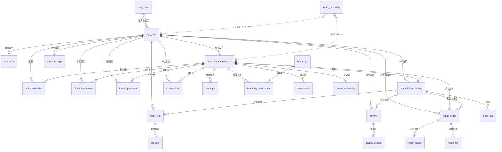

> 全局图 25 个实体、23 条关系。`sys_dict` 独立，不参与业务关系；`review_appeal` 只连 `review`。

---

## 3. 分域关系图

### 3.1 账号与权限

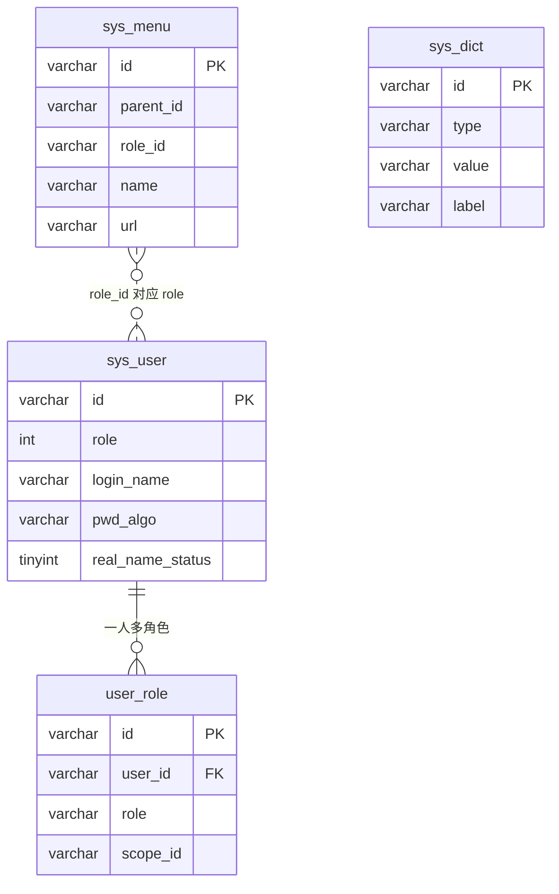

`sys_dict` 独立；`sys_menu.role_id` 不是 FK，对应 `sys_user.role` 的 0/1/2。

### 3.2 房源与媒体

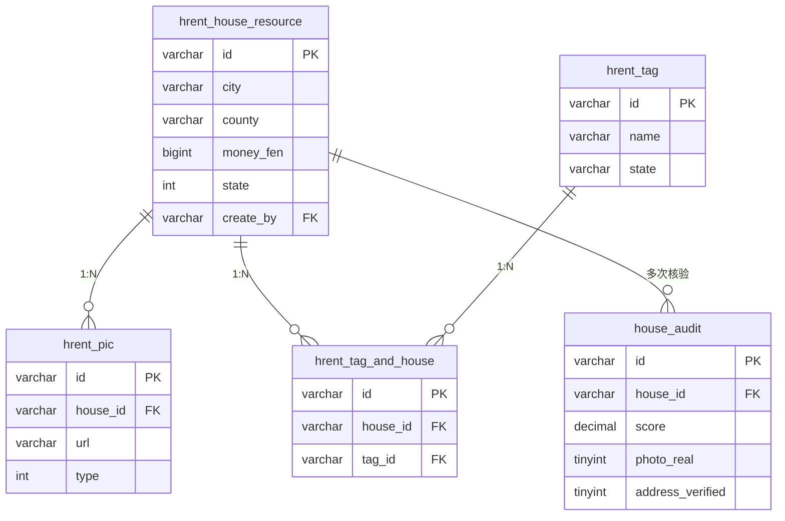

### 3.3 看房、申请与租约

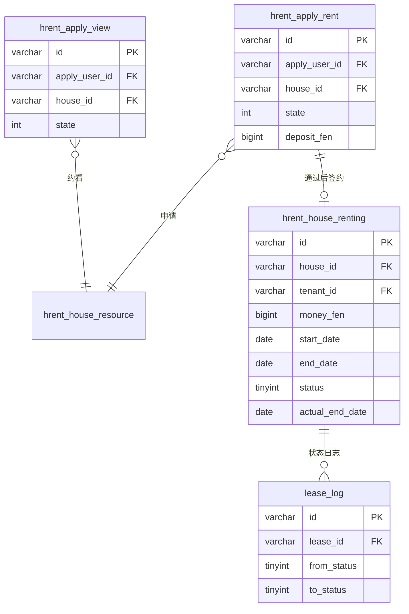

### 3.4 账单

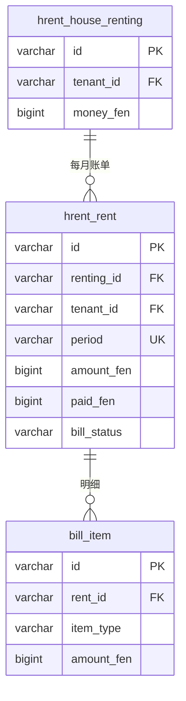

`uk_renting_period(renting_id, period)` 保证同租约同账期一张账单；`period` 为 NULL 时唯一键不生效。

### 3.5 报修

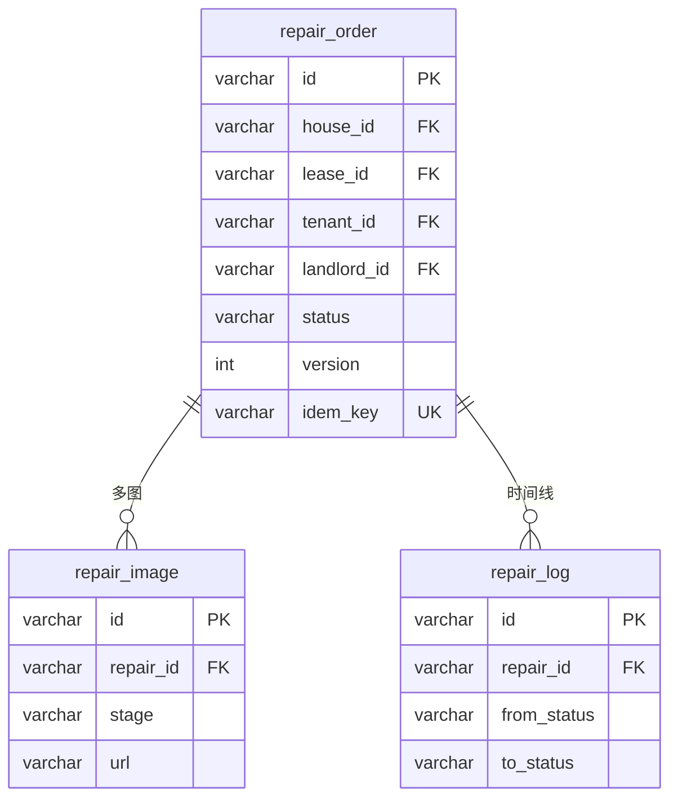

### 3.6 评价与核验

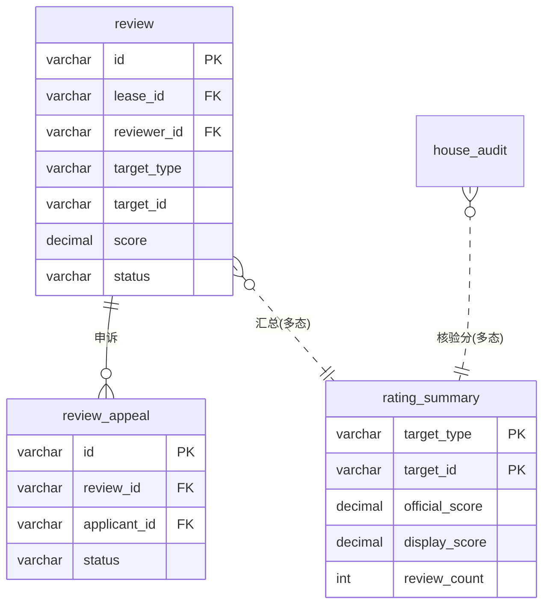

`rating_summary` 不是外键表，是汇总表；`target_id` 可指向 `hrent_house_resource.id` 或 `sys_user.id`，由 `target_type` 区分。

### 3.7 消息与 AI

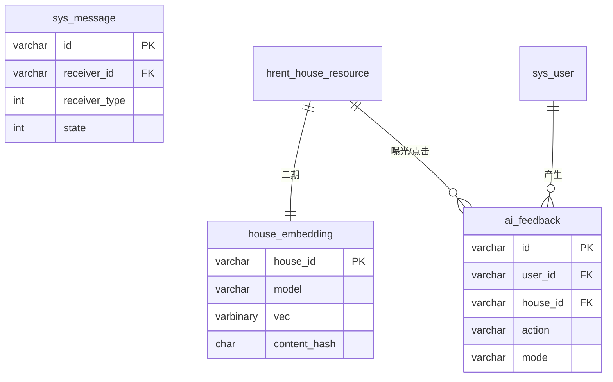

---

## 4. 关系清单

| ID | 主表 | 从表 | 基数 | 连接列 | 强制 | 保证方式 | 依据 |
|---|---|---|---|---|---|---|---|
| REL-01 | `sys_user` | `user_role` | 1:N | `user_id` | 否 | 唯一键 `(user_id,role)` | V2:29 |
| REL-02 | `sys_user` | `hrent_house_resource` | 1:N | `create_by` | 否 | 应用层 owner 校验 | V1:61 |
| REL-03 | `sys_user` | `hrent_collection` | 1:N | `user_id` | 否 | 应用层 + 索引 | V1:220 |
| REL-04 | `sys_user` | `hrent_apply_view` | 1:N | `apply_user_id` | 否 | 应用层 | V1:132 |
| REL-05 | `sys_user` | `hrent_apply_rent` | 1:N | `apply_user_id` | 否 | 应用层 | V1:153 |
| REL-06 | `sys_user` | `hrent_house_renting` | 1:N | `tenant_id` | 否 | 应用层 | V1:178 |
| REL-07 | `sys_user` | `hrent_rent` | 1:N | `tenant_id` | 否 | 应用层 | V1:201 |
| REL-08 | `sys_user` | `review` | 1:N | `reviewer_id` | 否 | 唯一键 + 应用层 | V3:44 |
| REL-09 | `sys_user` | `repair_order` | 1:N | `tenant_id` / `landlord_id` | 否 | 应用层 | V4:20-21 |
| REL-10 | `sys_user` | `sys_message` | 1:N | `receiver_id` | 否 | 应用层 | V1:238 |
| REL-11 | `sys_user` | `ai_feedback` | 1:N | `user_id` | 否 | 应用层 | V6:32 |
| REL-12 | `hrent_house_resource` | `hrent_pic` | 1:N | `house_id` | 否 | 应用层 | V1:81 |
| REL-13 | `hrent_house_resource` | `hrent_tag_and_house` | 1:N | `house_id` | 否 | 应用层 | V1:115 |
| REL-14 | `hrent_tag` | `hrent_tag_and_house` | 1:N | `tag_id` | 否 | 应用层 | V1:116 |
| REL-15 | `hrent_house_resource` | `house_audit` | 1:N | `house_id` | 否 | 应用层 + 时间索引 | V3:18 |
| REL-16 | `hrent_house_resource` | `hrent_apply_view` | 1:N | `house_id` | 否 | 应用层 | V1:133 |
| REL-17 | `hrent_house_resource` | `hrent_apply_rent` | 1:N | `house_id` | 否 | 应用层 | V1:154 |
| REL-18 | `hrent_house_resource` | `hrent_house_renting` | 1:N | `house_id` | 否 | 应用层 | V1:176 |
| REL-19 | `hrent_house_resource` | `hrent_collection` | 1:N | `house_id` | 否 | 应用层 | V1:218 |
| REL-20 | `hrent_house_resource` | `repair_order` | 1:N | `house_id` | 否 | 应用层 | V4:18 |
| REL-21 | `hrent_house_resource` | `house_embedding` | 1:1 | `house_id` | 否 | PK | V6:15 |
| REL-22 | `hrent_house_resource` | `ai_feedback` | 1:N | `house_id` | 否 | 应用层 | V6:34 |
| REL-23 | `hrent_house_renting` | `lease_log` | 1:N | `lease_id` | 否 | 应用层 | V2:111 |
| REL-24 | `hrent_house_renting` | `hrent_rent` | 1:N | `renting_id` | 否 | 唯一键 `(renting_id,period)` | V5:49 |
| REL-25 | `hrent_house_renting` | `review` | 1:N | `lease_id` | 否 | 唯一键 `(reviewer_id,target_type,target_id,lease_id)` | V3:58 |
| REL-26 | `hrent_house_renting` | `repair_order` | 1:N | `lease_id` | 否 | 应用层 | V4:19 |
| REL-27 | `hrent_rent` | `bill_item` | 1:N | `rent_id` | 否 | 应用层 + 金额校验 | V5:59 |
| REL-28 | `repair_order` | `repair_image` | 1:N | `repair_id` | 否 | 应用层 | V4:55 |
| REL-29 | `repair_order` | `repair_log` | 1:N | `repair_id` | 否 | 应用层 | V4:70 |
| REL-30 | `review` | `review_appeal` | 1:N | `review_id` | 否 | 唯一键 `(review_id,applicant_id)` | V3:80 |
| REL-31 | `rating_summary` | `hrent_house_resource` | N:1 | `target_id`（`target_type='HOUSE'`） | 否 | 应用层 + 定期清理 | V3:90 |
| REL-32 | `rating_summary` | `sys_user` | N:1 | `target_id`（`target_type='LANDLORD'`） | 否 | 应用层 + 定期清理 | V3:90 |
| REL-33 | `review` | `hrent_house_resource` | N:1 | `target_id`（`target_type='HOUSE'`） | 否 | 应用层 | V3:45 |
| REL-34 | `review` | `sys_user` | N:1 | `target_id`（`target_type='LANDLORD'`） | 否 | 应用层 | V3:45 |
| REL-35 | `sys_menu` | `sys_user` | N:M | `role_id` = `role` | 否 | 应用层 | V1:259 |

> 35 条关系，0 条物理外键。多态关系（REL-31..34）无法用 FK 表达，只能靠服务层校验 + 定期孤儿清理。

---

## 5. 无 FK 时的完整性由谁保证

| 层 | 手段 | 覆盖 |
|---|---|---|
| 数据库 | 主键、唯一键、CHECK、`NOT NULL` | 单表内 |
| 服务层 | 写前校验父记录存在、`owner_id` 校验、状态机校验 | 跨表 |
| 幂等 | `uk_idem`、`uk_renting_period`、`uk_reviewer_target` | 重复提交 |
| 并发 | `version` 乐观锁 | 接单/确认/退租 |
| 对账 | `verify.sql` 20 项 + 孤儿行检查 | 迁移后/每日 |
| 清理 | 定期删除无主 `bill_item`、`review`、`rating_summary` | 多态/日志 |

必须补的孤儿检查（当前 `verify.sql` 未覆盖）：

> **本节是这组 SQL 的权威版本**，`99_review_diff.sql` §2 的预检直接引用本节，不再各写一份；将来并入 `verify.sql` 时以本节为准。

```sql
-- 账单明细无主
SELECT i.id FROM bill_item i LEFT JOIN hrent_rent r ON r.id=i.rent_id WHERE r.id IS NULL;
-- 评价无主租约
SELECT v.id FROM review v LEFT JOIN hrent_house_renting h ON h.id=v.lease_id WHERE h.id IS NULL;
-- 汇总指向不存在目标
SELECT s.target_type,s.target_id FROM rating_summary s
LEFT JOIN hrent_house_resource h ON s.target_type='HOUSE' AND h.id=s.target_id
LEFT JOIN sys_user u ON s.target_type='LANDLORD' AND u.id=s.target_id
WHERE h.id IS NULL AND u.id IS NULL;
-- 账单主表无主租约（G-02 补漏，原清单没有这条）
SELECT r.id FROM hrent_rent r LEFT JOIN hrent_house_renting h ON h.id=r.renting_id WHERE h.id IS NULL;
-- 同一房源多条生效租约（G-15 对账口径）
SELECT house_id, COUNT(*) c FROM hrent_house_renting
WHERE status=0 AND del_flag=0 GROUP BY house_id HAVING c > 1;
```

---

## 6. 状态机

### 6.1 租约 `hrent_house_renting.status`

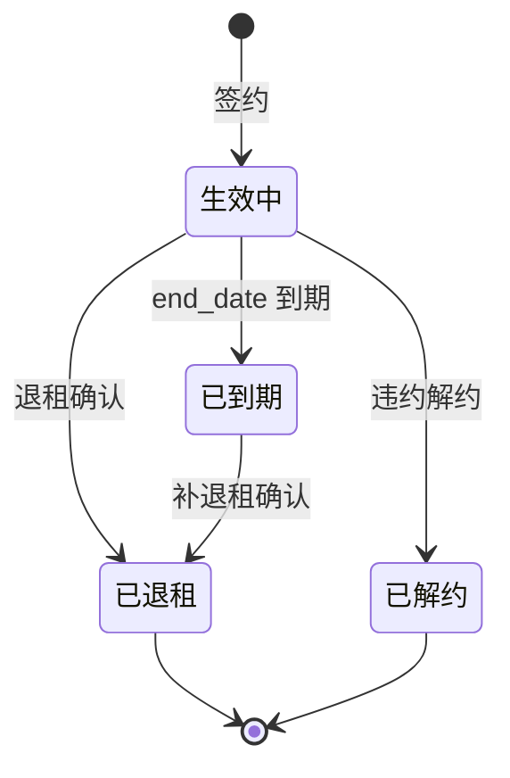

规则：`status=2` 且 `actual_end_date` 非空才开放评价；`version` 乐观锁。

### 6.2 账单 `hrent_rent.bill_status`

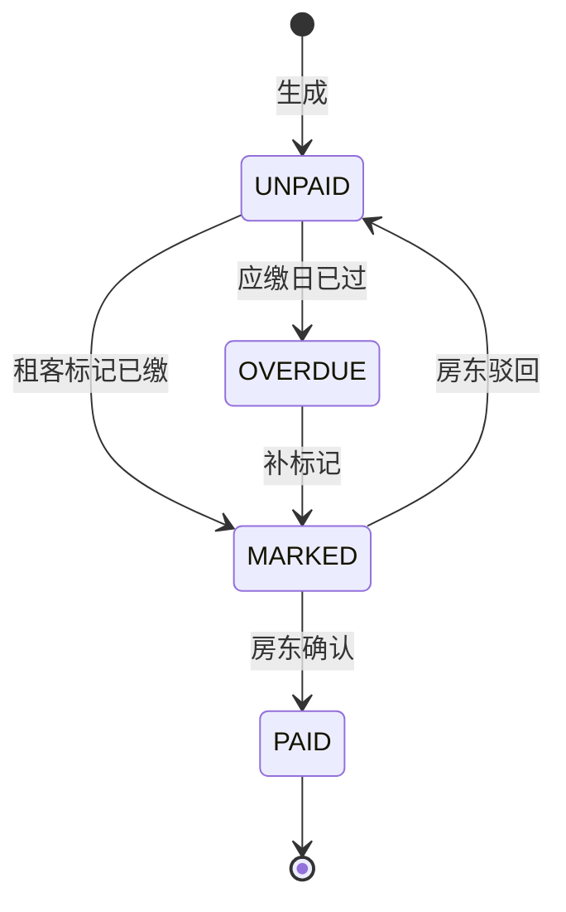

规则：重复确认返回 200 但不重复累加 `paid_fen`；`OVERDUE` 可由定时任务每日刷新。

### 6.3 报修 `repair_order.status`

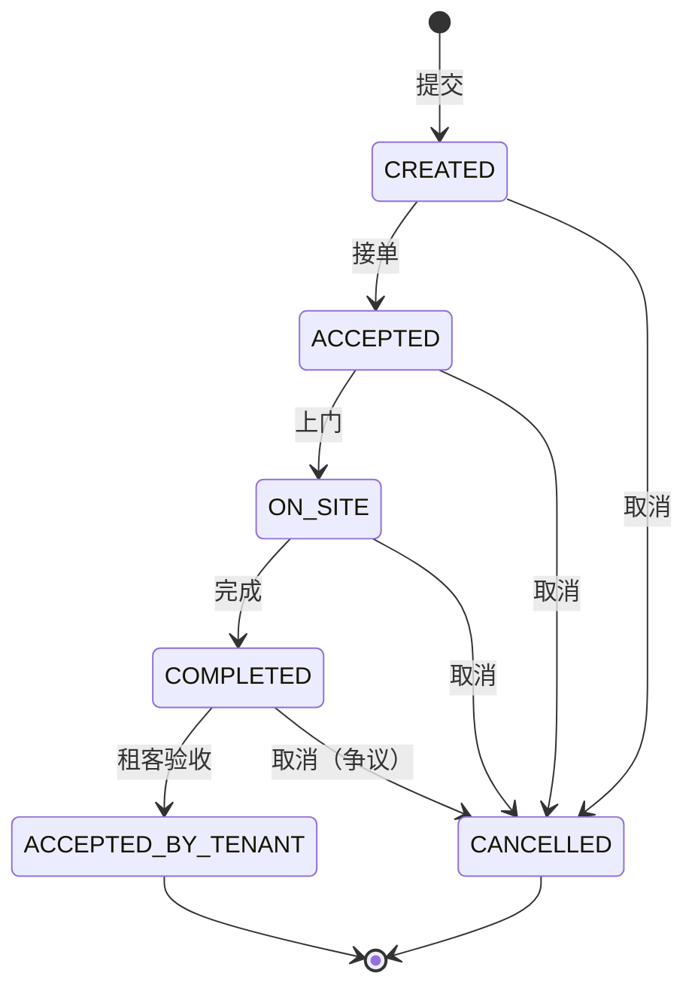

规则：5 状态 + 取消，共 6 状态；25 种组合中 20 条非法跳转必须拒绝（409）。

### 6.4 评价 `review.status`

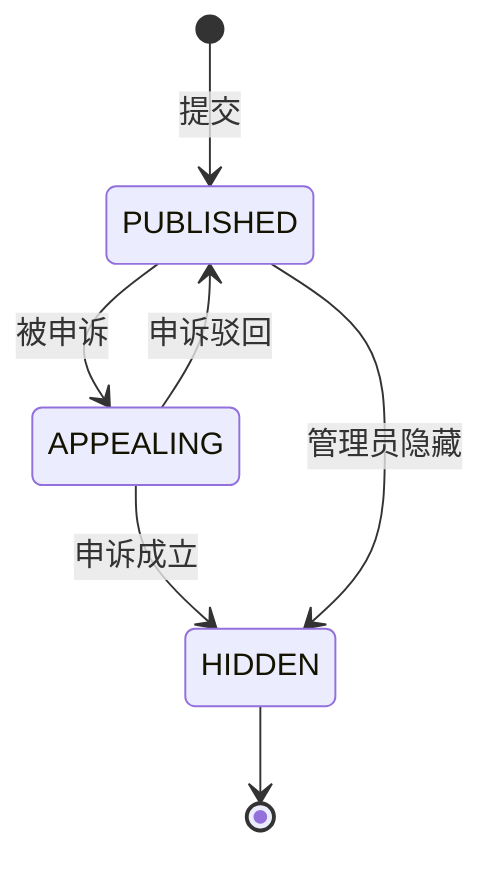

规则：`APPEALING` 期间不计入均分；`HIDDEN` 不计入；申诉 48h 处理。

### 6.5 房源 `hrent_house_resource.state`（补充）

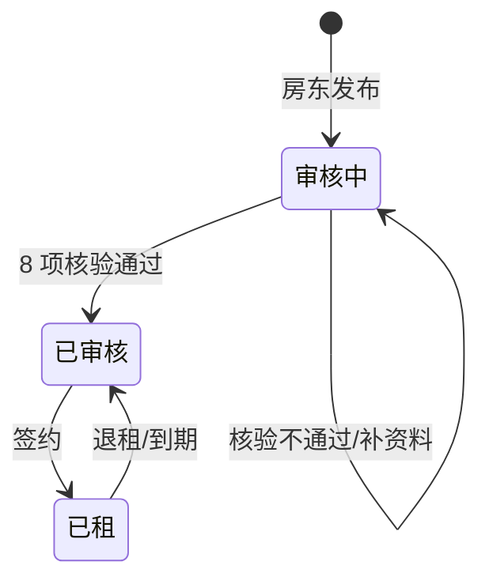

---

## 7. 渲染自检

| 项 | 结果 |
|---|---|
| Mermaid 语法 | 7 张 `erDiagram` + 5 张 `stateDiagram-v2`，无非法字符 |
| 实体覆盖 | 25/25 表在全局图或分域图出现 |
| 关系覆盖 | 35 条 REL 与图一致；多态关系单独说明 |
| 字段一致性 | 图中关键列与 `docs/15` 逐字一致 |
| 孤立实体 | `sys_dict` 独立；`house_embedding` 仅连房源 |
| 物理 FK | 0，与 `V1–V7` 一致 |
