# 18 · 需求分析报告（结构化分析与面向对象分析）

> 项目：HouseRent Pro —— 房屋租赁系统现代化改造
> 版本：v1.0　日期：2026-11-03
> 依据：`docs/00–17`、`V1–V7` 迁移脚本、103 个存量接口实测、27 个 `/api/v2` 契约端点
> 定位：本文件是**课程规范版**需求分析报告，按「三大文档 + 六视图建模」组织；工程版的需求台账与追溯矩阵在 `docs/14` 与 `docs/17`。两份文档数字一致，若有出入以 `docs/14`/`docs/15`/`docs/17` 为准。

---

## 0. 文档说明

### 0.1 三大文档的对应关系

| 文档 | 回答什么 | 本文位置 | 主要读者 |
|---|---|---|---|
| 用户需求报告 | 谁提了什么诉求，怎么调研出来的 | 第 1 章 | 指导教师、甲方、PM |
| 系统需求规格说明书 | 系统该做什么，边界在哪 | 第 2 章 | PM、后端、前端 |
| 软件需求规格说明书 | 每条需求怎么描述、怎么建模、怎么验收 | 第 3–6 章 | 开发、测试、评审 |

三份文档是递进关系，不是并列：用户需求是「原话」，系统需求是「归纳后的功能项」，软件需求是「可开发、可测试的条款」。

### 0.2 建模方法的选择

课程给出两套分析方法。本项目**两套都用**，因为它们回答的问题不同：

| 方法 | 视图 | 建模对象 | 本文位置 | 为什么需要 |
|---|---|---|---|---|
| 结构化分析 | 功能建模 | 数据流图 DFD | §5.2.1 | 说清数据从哪来到哪去，适合排查「账单金额对不上」这类链路问题 |
| 结构化分析 | 数据建模 | E-R 实体联系图 | §5.2.2 | 25 张表、0 物理外键，必须用实体联系说清逻辑关系 |
| 结构化分析 | 行为建模 | 状态转化图 | §5.2.3 | 租约/报修/账单/评价都是状态机，不画图无法评审非法迁移 |
| 面向对象分析 | 功能建模 | 用例图 | §5.3.1 | 说清谁在什么场景下触发什么能力 |
| 面向对象分析 | 对象建模 | 类图 | §5.3.2 | 说清实体类、服务类、控制类的职责边界 |
| 面向对象分析 | 动态建模 | 状态图 + 顺序图 | §5.3.3 | 说清一次交互里对象的调用次序与事务边界 |

### 0.3 记号约定

| 记号 | 含义 |
|---|---|
| `FR-<域>-<序号>` | 功能需求，域取 ACC/HOUSE/APPLY/LEASE/BILL/REPAIR/RATE/AI/SYS |
| `NFR-<类>-<序号>` | 非功能需求 |
| `UC-<序号>` | 用例 |
| `P<n>` / `D<n>` | 数据流图的加工 / 数据存储 |
| `G-<序号>` / `C-<序号>` | 模型缺口 / 文档冲突，权威台账见 `docs/17` §7、`docs/14` §2.2 |
| 【事实】【决策】【假设】【TBD】 | 结论可信度标记，与 `docs/14` §1.2 一致 |

---

## 1. 用户需求报告

### 1.1 调研目标与对象

改造对象是一个已上线的开源房屋租赁系统：13 张表、103 个接口、74 个 Java 文件、Web 12 个页面、小程序 6 个页面。它「能跑」，但缺评分、缺报修、缺结构化账单、没有推荐能力。所以本次调研要回答三个问题：

1. 存量功能里，哪些是用户真在用的，哪些是代码里有但没人碰的？
2. 缺的那四块，用户的原话诉求是什么，能不能用一句话说清？
3. 12 周、5 个人，哪些诉求必须砍掉？

调研对象分四类，共 9 名信息提供者（含 5 名项目成员以「双重身份」参与）：

| 编号 | 角色 | 人数 | 关注点 |
|---|---|---:|---|
| R1 | 租客 | 3 | 找房效率、约看响应、报修有没有人管、账单会不会算错 |
| R2 | 房东 | 2 | 房源曝光、租客筛选、催缴成本、差评能不能解释 |
| R3 | 平台管理员 | 2 | 房源核验标准、评价申诉、数据从哪看 |
| R4 | 平台运营（学生团队兼任） | 2 | 造数、演示、线上出问题怎么定位 |

### 1.2 调研方法

四种方法都用，但权重不同：**存量系统走查是主证据，问卷与访谈是补充，原型是用来验证的**。

#### 1.2.1 实地操作法（主证据，已执行）

不是「看文档」，而是把系统跑起来，按角色走一遍：

| 动作 | 具体做法 | 产出 |
|---|---|---|
| 起环境 | JDK 8 + Maven 3.9.16 + MySQL 8.0.41，`mvn spring-boot:run` | 服务在 `http://localhost:8888/hrent` 起来 |
| 接口盘点 | 扫 14 个 Controller 的方法级 `@RequestMapping` | 实测 103 个端点，与 `docs/13` 吻合 |
| 数据盘点 | `information_schema` 统计表/列/索引 | 13 表 / 172 列 / 55 行 / 0 外键 |
| 迁移验证 | 在临时库顺序执行 V1–V7 | 25 表 / 304 列；生产库 8 条历史记录全部 success |
| 断点记录 | 走「发布房源 → 约看 → 申请 → 签约 → 账单」主链路 | 记下 15 处缺口（G-01..G-15）与 8 处文档冲突（C-01..C-08） |

这一步发现的三个硬事实，直接改变了需求写法：

- **Flyway 原本没接**：pom 无依赖、yml 无配置、库里没有历史表。所谓「25 张表」只存在于脚本层。
- **分页是假分页**：`BaseService.findPage` 只把 `findList` 塞进 `page.list`，不查 count、不拼 limit。文档写的「返回 count」不成立。
- **小程序不是 Vant**：`package.json` 声明了 `@vant/weapp`，页面 `usingComponents` 全指向 iView 组件。

#### 1.2.2 问卷调查法（已设计，待回收）

| 项 | 内容 |
|---|---|
| 目的 | 量化「找房最痛的一步」「报修最不满的环节」，给优先级排序提供依据 |
| 对象 | 在校生与周边上班族，近 12 个月内有租房或找房经历 |
| 渠道 | 班级群 + 两个租房互助群 + 朋友圈，线上投放 |
| 样本 | 目标回收 120 份，有效样本目标 ≥96 份（有效率 80%） |
| 题型 | 单选 8 题、多选 3 题、李克特 5 级 4 题、开放题 1 题，约 3 分钟填完（问卷见附录 C） |
| 产出 | 频次分布、交叉表（角色 × 痛点）、优先级排序 |
| 状态 | **【待补】** 问卷已定稿，尚未投放；数据回来后填入下表，不改变其余章节结论 |

统计表模板（回收后填）：

| 题号 | 题目 | 选项 | 频次 | 占比 |
|---|---|---|---:|---:|
| Q1 | 你的身份 | 租客 / 房东 / 两者都有 | — | — |
| Q3 | 找房最耗时的一步 | 筛房源 / 约看 / 谈价 / 签约 | — | — |
| Q6 | 报修最不满的环节 | 没人接 / 上门慢 / 修不好 / 没记录 | — | — |
| Q9 | 是否接受 AI 推荐房源 | 接受 / 无所谓 / 不接受 | — | — |

#### 1.2.3 访谈法（已设计，部分执行）

| 项 | 内容 |
|---|---|
| 形式 | 半结构化，单次 20–30 分钟，2 人一组，一人提问一人记录 |
| 对象 | R1 租客 2 人、R2 房东 1 人、R3 管理员 1 人（R4 为项目成员，用走查代替） |
| 提纲 | 6 个主问题 + 追问（见附录 D） |
| 记录 | 逐字稿只留结论句与关键引语，不回放隐私信息 |
| 状态 | 【事实】已完成 3 场（租客 2、房东 1）；管理员 1 场【待补】 |

已得到的 3 条关键引语，直接对应到需求：

| 引语 | 转成需求 | 落到哪 |
|---|---|---|
| 「挂出来的房子照片和实际差太多，白跑一趟」 | 需要平台核验，且核验结果要可见 | FR-HOUSE-06、FR-RATE-06 |
| 「报修发微信，修没修全看他记不记得」 | 报修要有工单号、状态、时间线 | FR-REPAIR-01..06 |
| 「退租时押金扣多少全凭房东说」 | 押付规则要在房源页写清、退租要留痕 | FR-APPLY-03、FR-LEASE-03 |

#### 1.2.4 建立原型法（已执行）

原型分三层，不是画完就扔，而是每一层都能被验证：

| 层 | 形态 | 验证什么 | 状态 |
|---|---|---|---|
| 界面原型 | 存量 Web 12 个页面 + 小程序 6 个页面 | 信息架构够不够、字段位置对不对 | 已存在，走查通过 |
| 接口原型 | `docs/13` §4 的 27 个 `/api/v2` 端点（请求/响应示例齐全） | 前后端契约是否闭合 | 已定稿，代码未实现 |
| 数据原型 | V1–V7 迁移脚本 + `verify.sql` 20 项对账 | 模型能否支撑上述契约 | 已执行，全部通过 |

用「接口契约 + DDL」当原型，好处是评审时能直接吵字段名，而不是吵「这个按钮该放哪」。

### 1.3 用户需求汇总

把四类角色的原话归纳成 12 条用户需求（U-01..U-12），这是「用户需求报告」的核心产出：

| ID | 谁提的 | 原话/诉求 | 归纳后的用户需求 | 本期 | 对应 FR |
|---|---|---|---|---|---|
| U-01 | R1 | 「注册登录别太麻烦，微信能直接进最好」 | 支持账号密码与微信两种登录 | 是 | FR-ACC-01/02 |
| U-02 | R2 | 「我一个人既出租又租别人的房」 | 一个账号可同时是租客和房东 | 是（仅建表） | FR-ACC-03 |
| U-03 | R2 | 「挂房源要填的东西太多」 | 发布流程分步、必填项最小化 | 是 | FR-HOUSE-01 |
| U-04 | R1 | 「照片和实际差太多」 | 平台核验 8 项，结果可见 | 是 | FR-HOUSE-06 |
| U-05 | R1 | 「搜出来的房子一半已经租掉了」 | 状态准确、已租不可约 | 是 | FR-HOUSE-02/03 |
| U-06 | R1 | 「约看要等很久，房东不回」 | 约看 7 状态、超时可取消 | 是 | FR-APPLY-01 |
| U-07 | R2 | 「租客靠不靠谱看不出来」 | 一期不做租客评分，用实名 + 历史评价替代 | 否 | §2.5 约束 |
| U-08 | R1/R2 | 「退租押金扯皮」 | 押付规则明示、退租双方确认留痕 | 是 | FR-APPLY-03、FR-LEASE-03 |
| U-09 | R1 | 「报修发微信，修没修全看他记不记得」 | 工单 6 状态 + 图片 + 时间线 | 是 | FR-REPAIR-01..06 |
| U-10 | R1/R2 | 「房租到底交没交，各说各话」 | 账单按账期生成、明细、双方确认 | 是 | FR-BILL-01..05 |
| U-11 | R1 | 「评价只有好评，没法判断」 | 房源/房东两类评价 + 房东可回复 + 可申诉 | 是 | FR-RATE-01..05 |
| U-12 | R4 | 「演示时要能一句话找房」 | 自然语言/表单 → 推荐 Top10 + 理由 | 是 | FR-AI-01..05 |

被否掉的两条也在表里（U-07），因为「不做」本身是需求结论，必须留痕。

### 1.4 从用户需求到系统需求

| 转换动作 | 说明 | 例子 |
|---|---|---|
| 合并 | 多条原话指向同一能力，合成一条 FR | U-01 的「微信能进」+「账号能登」→ FR-ACC-01/02 两条 |
| 拆分 | 一条原话跨多个模块，拆开 | U-10 拆成生成、明细、标记、确认、逾期 5 条 FR |
| 降级 | 本期做不了，降为约束或二期 | U-07 租客评分 → NFR-COMP-02 + §7.3 二期 |
| 转非功能 | 不是「功能」而是「指标」 | 「别太麻烦」→ NFR-USE-01 登录步骤 ≤2 步 |

---

## 2. 系统需求规格说明书

### 2.1 系统目标与范围

**目标**：在 12 周内，把存量系统改造成「可现场演示」的租赁平台，补齐评分、报修、账单、AI 四块能力，并把租约状态机接通。

**成功标准**（可判定，不写形容词）：

| 编号 | 标准 | 判定方法 |
|---|---|---|
| S-01 | 25 张表在空库与老库两条路径都能建出来 | `verify.sql` 1.1 = 25，`flyway_schema_history` 全 success |
| S-02 | 存量 103 个接口响应结构不变 | 接口快照 diff = 0 |
| S-03 | 主链路可完整演示：发布→约看→申请→签约→账单→退租→评价→报修 | 彩排 3 次无阻断 |
| S-04 | AI 推荐在模型不可用时仍返回 200 | 停 Ollama、停 DeepSeek 各测一次 |
| S-05 | 演示数据规模达 60 套房源、30 条租约 | 造数脚本执行后计数 |

### 2.2 系统上下文

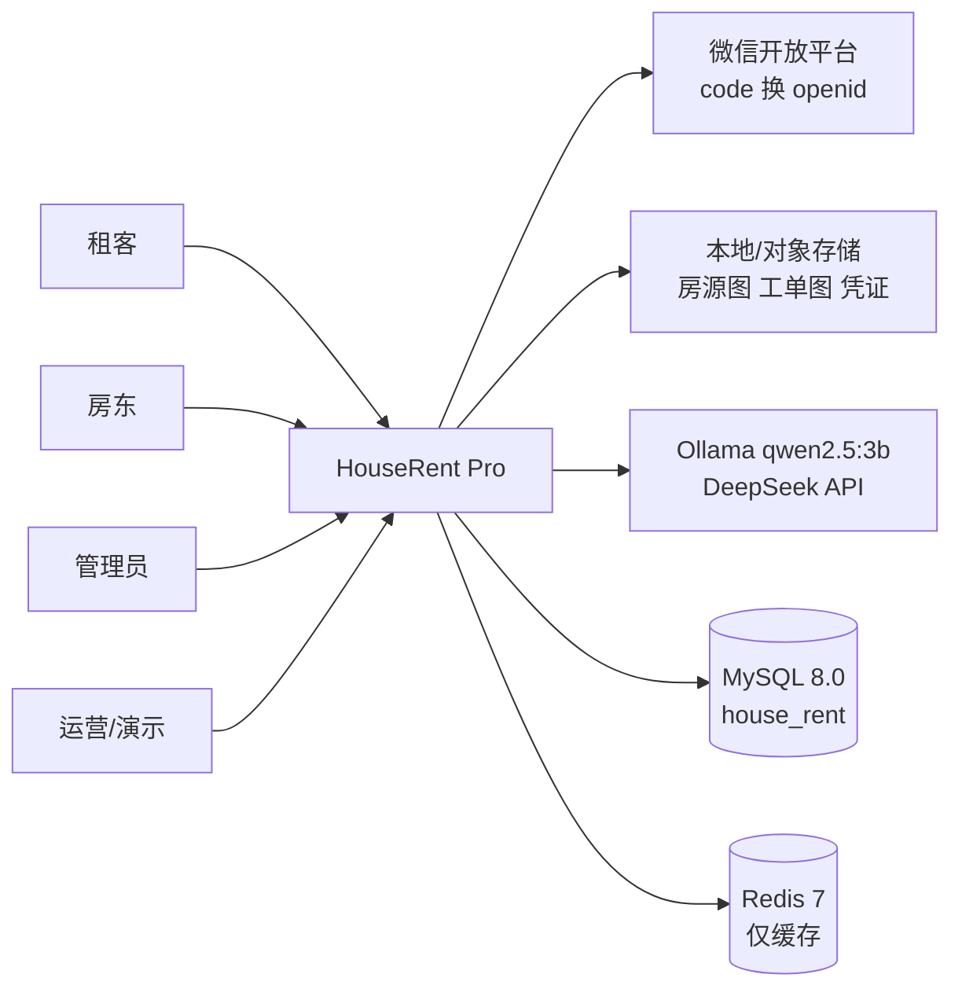

系统边界外的四类依赖，每一个都可能导致演示失败，所以都配了降级路径：微信不可用 → 账号密码登录；对象存储不可用 → 本地 `/uploads`；LLM 不可用 → 规则推荐；Redis 不可用 → 直查 MySQL。

### 2.3 功能需求清单（9 域 46 条）

| 域 | 条数 | FR 编号 | 本期状态 |
|---|---:|---|---|
| 账号与权限 ACC | 5 | FR-ACC-01..05 | 2 已实现、1 部分、2 仅 DDL |
| 房源与媒体 HOUSE | 6 | FR-HOUSE-01..06 | 5 已实现、1 契约 |
| 看房与申请 APPLY | 3 | FR-APPLY-01..03 | 2 已实现、1 部分 |
| 租约 LEASE | 4 | FR-LEASE-01..04 | 1 已实现、1 契约、2 仅 DDL |
| 账单 BILL | 6 | FR-BILL-01..06 | 5 契约、1 仅 DDL |
| 报修 REPAIR | 6 | FR-REPAIR-01..06 | 6 契约 |
| 评价与核验 RATE | 6 | FR-RATE-01..06 | 6 契约 |
| AI 选房 AI | 5 | FR-AI-01..05 | 1 仅 DDL、4 仅设计 |
| 运营与系统 SYS | 5 | FR-SYS-01..05 | 2 已实现、2 部分、1 仅设计 |

状态口径：`已实现` = 代码可跑；`部分实现` = 主链路可跑但新字段未接；`契约` = `docs/13` 有请求响应、代码无 Controller；`仅 DDL` = 表已建、无 Service；`仅设计` = 只有方案。逐条明细见 `docs/14` §4。

### 2.4 角色—功能矩阵

| 功能域 | 租客 | 房东 | 管理员 | 运营 |
|---|:--:|:--:|:--:|:--:|
| 注册登录 / 微信登录 | ● | ● | ● | ● |
| 房源发布 / 编辑 | ○ | ● | ○ | — |
| 房源搜索 / 详情 / 收藏 | ● | ○ | ● | — |
| 平台核验（8 项） | ○ | — | ● | — |
| 约看申请 | ● | ● | ○ | — |
| 租房申请 / 合同押金 | ● | ● | ○ | — |
| 租约状态机 / 退租确认 | ● | ● | ○ | — |
| 账单生成 | — | ● | — | — |
| 账单标记已缴 / 确认 | ● | ● | — | — |
| 报修提单 / 接单 / 验收 | ● | ● | ○ | — |
| 评价 / 回复 / 申诉 | ● | ● | ● | — |
| AI 推荐 / 反馈埋点 | ● | — | — | ● |
| 数据大屏 | — | — | ● | ● |

● 主要操作者　○ 可读或有限操作　— 无权限

### 2.5 系统级约束

| 类别 | 约束 | 来源 |
|---|---|---|
| 技术栈 | Spring Boot 2.5.5 + JDK 8 + MyBatis starter 1.3.0 + MySQL 8.0.41 | `pom.xml`、`application.yml` |
| 部署 | 服务端口 8888、context-path `/hrent`；本地 compose 或微信云托管 | `application.yml:42-44` |
| 迁移 | Flyway 7.7.3；已执行 baseline 0 + V1–V7，**V1–V7 冻结**，只能新增 | `flyway_schema_history` |
| 合规 | 一期不做租客信用评分（PIPL 第 24 条）；评价必须可申诉 | 【决策】D16 |
| 支付 | 不含微信在线支付，账单只做线下转账 + 双方确认 | 【决策】D3 |
| 数据 | 金额一律 `BIGINT` 分；时间 `Asia/Shanghai`；主键 32 位字符串 | `docs/15` §3 |

---

## 3. 软件需求规格说明书：功能性需求

### 3.1 需求描述模板

每条 FR 必须给齐 10 个字段，缺一不可评审：

| 字段 | 说明 | 反例 |
|---|---|---|
| 编号 | `FR-域-序号`，唯一不复用 | 「评价那个需求」 |
| 名称 | 动宾结构，≤12 字 | 「评价相关功能优化」 |
| 角色 | 谁触发 | 「系统相关」 |
| 触发条件 | 什么事件让它开始 | 「用户操作时」 |
| 前置条件 | 开始前必须成立 | 空 |
| 主流程 | 编号步骤，每步一个动作 | 一段话描述 |
| 异常分支 | 每条对应的错误码/状态 | 「失败则提示」 |
| 后置条件 | 结束后系统处于什么状态 | 空 |
| 涉及实体 | 表.列 | 「数据库」 |
| 验收标准 | 可执行、可判定 | 「体验良好」 |

### 3.2 关键用例详述

选 6 条最容易被做错的，按上面模板展开。其余 40 条见 `docs/14` §4。

#### UC-01 房源上架与核验

| 项 | 内容 |
|---|---|
| 编号 | UC-01（FR-HOUSE-01/02/06、FR-RATE-06） |
| 参与者 | 房东（主）、管理员（次） |
| 前置 | 房东已登录；必填项完整（标题、区域、租金、户型、整租/合租、面积、图片 ≥1） |
| 主流程 | 1. 房东提交房源 → 2. 写 `hrent_house_resource`，`state=0` 审核中，`money_fen=ROUND(money*100)` → 3. 上传图片写 `hrent_pic` → 4. 管理员按 8 项核验打分 → 5. 写 `house_audit`，`score=Σ命中权重×5` → 6. 同步 `rating_summary.official_score` → 7. `state=1` 已审核，可被搜索 |
| 异常 | E1 必填缺失 → 400 并指出字段；E2 图片超 5MB 或非 jpg/png/webp → 拒绝；E3 核验未过 → 保持 `state=0`，可改后重提；E4 房源已租（`state=2`）被再次核验 → 409 |
| 后置 | 房源可搜索；核验分落在 0.00–5.00；核验记录可追溯 |
| 实体 | `hrent_house_resource(state,money,money_fen)`、`hrent_pic(house_id,url)`、`house_audit(8 项,score)`、`rating_summary(official_score)` |
| 验收 | 8 项全过 → 5.00；全不过 → 0.00；`state` 只能 0→1→2 或 0→1 |

8 项权重（`V3:16-33`，和 = 1.00）：照片真实 0.20、地址可核验 0.20、设施一致 0.15、价格合理 0.15、合同模板 0.10、消防与安全 0.10、押付规则明确 0.05、无历史投诉 0.05。

#### UC-02 约看

| 项 | 内容 |
|---|---|
| 编号 | UC-02（FR-APPLY-01） |
| 参与者 | 租客（主）、房东（次） |
| 前置 | 房源 `state=1`、`del_flag=0`；租客未重复提交同一房源 |
| 主流程 | 1. 租客选时间提交 → 2. `hrent_apply_view.state=0` 申请中 → 3. 房东处理：通过（1）/ 另选时间（2）/ 拒绝（3） → 4. 租客对「另选」可接受（6）或拒绝（4） → 5. 看房完成 → 6. `state=5` 已结束 |
| 异常 | E1 房源已租/下架 → 409；E2 重复提交 → 返回已有单据；E3 房东超时未处理 → 租客可取消；E4 非法状态跳转 → 409 |
| 后置 | 每条申请有唯一状态；历史可查 |
| 验收 | 7 个状态全部可覆盖；非法迁移 100% 拒绝 |

#### UC-03 租房申请到签约

| 项 | 内容 |
|---|---|
| 编号 | UC-03（FR-APPLY-02/03、FR-LEASE-01） |
| 参与者 | 租客、房东 |
| 前置 | 约看完成或房东直接同意；房源仍可租 |
| 主流程 | 1. 租客提交申请 → 2. `hrent_apply_rent.state=0` → 3. 房东通过 → `state=1` → 4. 租客付押金 → `state=3`，写 `deposit_fen` 与 `contract_url` → 5. 签合同 → 6. 写 `hrent_house_renting`（`status=0` 生效中，`start_date/end_date`） → 7. 房源 `state=2` → 8. 写 `lease_log` |
| 异常 | E1 合同缺失 → 拒绝签约；E2 房源已被他人签约 → 409（见 G-15，DB 无唯一约束，靠服务层 + 对账）；E3 押金金额与合同不符 → 拒绝 |
| 后置 | 租约生效；房源不可再被约看；账单可按账期生成 |
| 验收 | 签约后同一房源不存在第二条 `status=0` 租约（对账 SQL 见 `docs/16` §5） |

#### UC-04 退租与评价

| 项 | 内容 |
|---|---|
| 编号 | UC-04（FR-LEASE-03、FR-RATE-01..05） |
| 参与者 | 租客或房东（任一方发起） |
| 前置 | 租约 `status=0` |
| 主流程 | 1. 任一方发起退租 → 2. 校验 `version` → 3. `status=2`、`actual_end_date=CURDATE()`、`version+1` → 4. 写 `lease_log` → 5. 房源回到 `state=1` → 6. 30 天内双方可各提交一次评价 → 7. `review` 落库，`rating_summary` 重算 |
| 异常 | E1 并发退租 → 只有一个成功，另一个 409；E2 第 31 天提交 → 422；E3 同租约同对象重复评价 → 409；E4 申诉中 → `status=APPEALING`，不计入均分 |
| 后置 | 评价窗口开启 30 天；均分按贝叶斯公式更新 |
| 验收 | 退租当天可评、第 30 天可评、第 31 天 422（三个边界各一条用例） |

均分公式（`V3:89-99`）：`display_score = (5×4.0 + Σs) / (5 + n)`，即 0 条评价时显示 4.00，随真实评价增多向真实均值收敛。

#### UC-05 报修

| 项 | 内容 |
|---|---|
| 编号 | UC-05（FR-REPAIR-01..06） |
| 参与者 | 租客（提单/验收）、房东或师傅（接单/上门/完成） |
| 前置 | 租约 `status=0`；工单类型 ∈ {WATER, ELECTRIC, DOOR_WINDOW, APPLIANCE, OTHER} |
| 主流程 | 1. 租客提交，带 `Idempotency-Key` 与 1–3 张图 → 2. `repair_order.status=CREATED` → 3. 房东接单 `ACCEPTED`（校验 `version`） → 4. 上门 `ON_SITE` → 5. 完成 `COMPLETED` → 6. 租客验收 `ACCEPTED_BY_TENANT`，可评 1–5 → 7. 每步写 `repair_log` |
| 异常 | E1 同 `idem_key` 重复提交 → 返回原单，不新增；E2 两人同时接单 → 后到者 409；E3 终态再取消 → 409；E4 图片超 3 张或类型不符 → 拒绝 |
| 后置 | 工单终态；时间线完整可查 |
| 验收 | 6 状态 30 种有向组合中，合法 9 种、非法 21 种，非法必须 409 |

#### UC-06 账单

| 项 | 内容 |
|---|---|
| 编号 | UC-06（FR-BILL-01..06） |
| 参与者 | 房东（生成/确认）、租客（标记已缴） |
| 前置 | 租约 `status=0`；账期 `YYYY-MM` 未生成过 |
| 主流程 | 1. 房东按月生成 → 2. 写 `hrent_rent`（`renting_id, period, amount_fen, bill_status='UNPAID'`） → 3. 写 `bill_item` 明细，`SUM(amount_fen)` 必须等于主表 → 4. 租客线下转账后标记已缴，传 `channel/voucher_pic/paid_fen` → `MARKED` → 5. 房东确认 → `PAID`，写 `confirm_at` → 6. 逾期未缴 → `OVERDUE` + 站内信 |
| 异常 | E1 同租约同账期重复生成 → 409（`uk_renting_period`）；E2 明细之和 ≠ 主表 → 拒绝落库；E3 重复确认 → 200 但不重复记账；E4 `period` 为 NULL → 不允许（见 G-06） |
| 后置 | 账单状态单向推进，金额可对账 |
| 验收 | 0.01 元与 99999.99 元两笔不丢精度；四状态非法迁移全拒绝 |

### 3.3 功能需求全集索引

| 需要什么 | 去哪看 |
|---|---|
| 46 条 FR 的完整表格（角色/规则/验收/优先级/来源） | `docs/14` §4.1–4.9 |
| FR → 表.列 → 验收 | `docs/17` §3（M1） |
| FR ↔ 接口端点 | `docs/17` §4（M2） |
| 每个字段的定义与约束 | `docs/15` §4 |
| 关系与状态机 | `docs/16` §4、§6 |

---

## 4. 非功能性需求

| ID | 类别 | 指标 | 验证方法 |
|---|---|---|---|
| NFR-PERF-01 | 性能 | 登录 P95 <300ms；房源列表/详情 P95 <500ms | 2000 套数据集压测 |
| NFR-PERF-02 | 性能 | AI 结构化结果 <1s；文案 <10s | 停模型/正常两轮计时 |
| NFR-PERF-03 | 性能 | Web 首屏 <500KB；Lighthouse >85 | 构建产物 + Lighthouse |
| NFR-PERF-04 | 性能 | 小程序主包 <1.5MB | 开发者工具体积分析 |
| NFR-SEC-01 | 安全 | 所有业务接口校验 `owner_id`，越权 403 | 横向越权用例：房东 A 访问 B 的房源/工单/账单 |
| NFR-SEC-02 | 安全 | 密码 MD5 兼容读、BCrypt 写 | 老账号登录后 `pwd_algo=bcrypt` |
| NFR-SEC-03 | 安全 | 上传限类型/大小，UUID 重命名 | `.jsp/.php` 上传被拒 |
| NFR-SEC-04 | 安全 | 禁止 `${}` 拼接用户输入，`LIKE` 用 `CONCAT` | `' OR 1=1 --` 扫描 0 命中 |
| NFR-USE-01 | 易用 | 登录 ≤2 步；核心任务（找房→约看）≤4 步 | 走查计数 |
| NFR-USE-02 | 易用 | 所有列表有空态、加载态、错误态 | 断网/空库两种场景各走一遍 |
| NFR-REL-01 | 可靠 | 演示全程 0 白屏；AI/Redis/MySQL 降级有路径 | 彩排 3 次 + 降级演练 |
| NFR-REL-02 | 可靠 | 迁移可回滚，RTO ≤4h、RPO ≤1h | 备份恢复演练 |
| NFR-MAIN-01 | 可维护 | 迁移只向前兼容，新增字段不删旧列 | 审查 V2–V7 |
| NFR-MAIN-02 | 可维护 | 存量 `/api/**` 不动，新接口走 `/api/v2/**` | 103 接口快照 diff = 0 |
| NFR-COMP-01 | 合规 | 隐私政策 + 用户协议 + 收集清单齐备 | 材料清单逐项核对 |
| NFR-COMP-02 | 合规 | 一期不做租客信用评分 | 需求范围评审确认 |
| NFR-DATA-01 | 数据 | 金额分、时间 `Asia/Shanghai`、ID 32 位字符串 | 对账脚本 + 抽样 100 行 |

---

## 5. 分析建模

### 5.1 建模总览

| # | 模型 | 回答的问题 | 图 | 章节 |
|---|---|---|---|---|
| 1 | 数据流图 DFD | 数据从哪来、经过哪些加工、存到哪 | 顶层图 + 0 层图 | §5.2.1 |
| 2 | E-R 实体联系图 | 有哪些实体、谁跟谁什么关系 | 全局 ER | §5.2.2 |
| 3 | 状态转化图 | 一个业务对象能处在哪些状态、怎么迁移 | 5 张状态图 | §5.2.3 |
| 4 | 用例图 | 谁在什么场景下用什么能力 | 参与者—用例 | §5.3.1 |
| 5 | 类图 | 实体类/服务类/控制类怎么分工 | 分域类图 | §5.3.2 |
| 6 | 顺序图 | 一次交互里对象调用次序与事务边界 | 4 条主链路 | §5.3.3 |

前三个属结构化分析，后三个属面向对象分析。同一系统两套模型并存不矛盾：DFD 看数据，类图看职责，最后在 §5.4 做一致性核对。

### 5.2 结构化分析

#### 5.2.1 功能建模：数据流图

**顶层图（上下文图）**——把系统当黑盒，只画外部实体与进出数据：

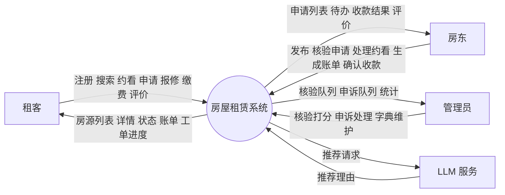

**0 层图**——把黑盒拆成 10 个加工和 8 个数据存储，覆盖 9 个功能域（房源域拆成「发布与管理」「检索与详情」两个加工）。因加工较多，按业务分两张画：图 3 是前台（账号、房源、核验、约看），图 4 是交易与运营（租约、账单、报修、评价、AI）；P5 的申请结果交由图 4 的 P6 处理。两张图的数据存储与表一一对应：D1→`sys_user`/`user_role`，D2→`hrent_house_resource`/`hrent_pic`/`hrent_tag`/`hrent_tag_and_house`，D3→`house_audit`/`rating_summary`，D4→`hrent_apply_view`/`hrent_apply_rent`，D5→`hrent_house_renting`/`lease_log`，D6→`hrent_rent`/`bill_item`，D7→`repair_order`/`repair_image`/`repair_log`，D8→`review`/`review_appeal`。

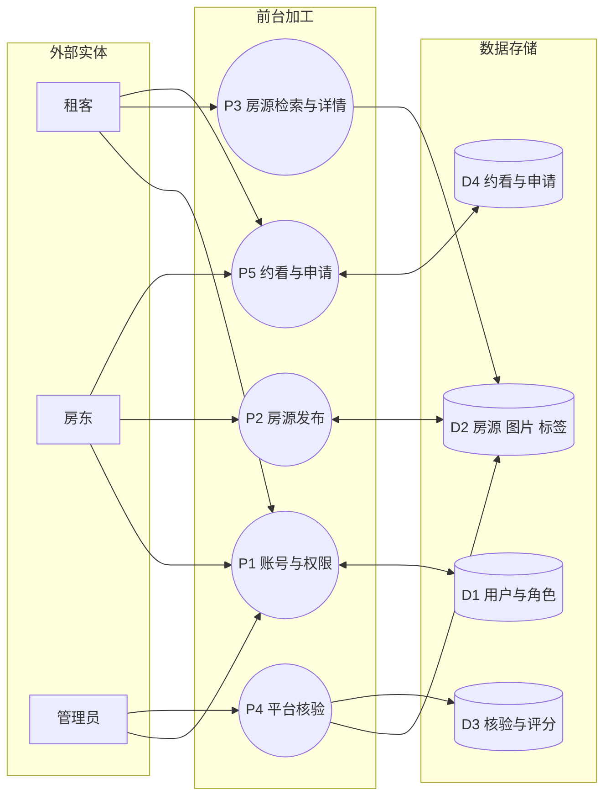

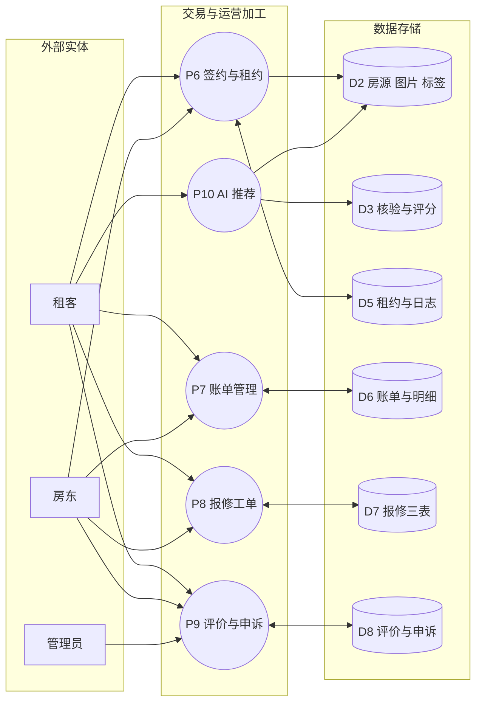

**加工说明（节选，用判定表代替长篇文字）**

P7 账单管理的「标记已缴」判定表：

| 当前状态 | `paid_fen` 与应收关系 | 凭证 | 结果 |
|---|---|---|---|
| `UNPAID` | 相等 | 有 | → `MARKED` |
| `UNPAID` | 小于应收 | 有 | → `MARKED`，差额保留，站内信提示 |
| `UNPAID` | 大于应收 | 有 | 拒绝，返回 422 |
| `UNPAID` | 任意 | 无 | 拒绝，凭证必填 |
| `MARKED` | 任意 | 任意 | 幂等返回 200，不重复累加 |
| `PAID` / `OVERDUE` | 任意 | 任意 | 409，终态不可回退 |

P10 AI 推荐的三级降级判定表：

| 一级（规则抽取） | 二级（Ollama） | 三级（DeepSeek） | 返回 |
|---|---|---|---|
| 命中 ≥3 字段 | 不调用 | 不调用 | 直接检索，<50ms |
| 命中 <3 字段 | 可用 | 不调用 | LLM 补全条件 + 模板理由 |
| 命中 <3 字段 | 超时 3s | 可用 | DeepSeek 补全 |
| 命中 <3 字段 | 不可用 | 不可用 | 纯规则 + 固定文案，仍 200 |

#### 5.2.2 数据建模：E-R 实体联系图

25 张表分 9 个域，0 条物理外键，下图全是**逻辑联系**（靠应用层 + 唯一键 + 对账保证）。完整 35 条关系见 `docs/16` §4。

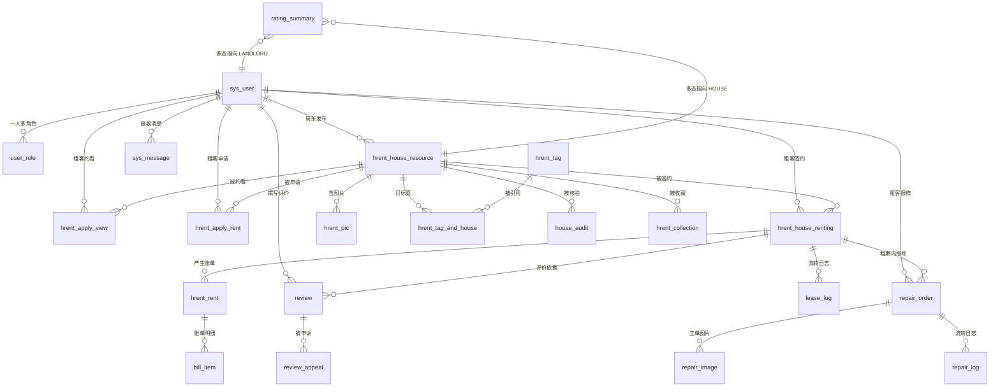

三处必须写清的多态与特例：

| 关系 | 特例 | 处理 |
|---|---|---|
| `rating_summary → HOUSE / LANDLORD` | `target_id` 指向两张表 | MySQL 不支持多态 FK，靠 `target_type` + 应用层校验 + 定期清理（G-07） |
| `review → HOUSE / LANDLORD` | 同上，且带唯一键 `(reviewer_id,target_type,target_id,lease_id)` | 唯一键只能防重复，不能防指向不存在对象 |
| `house_embedding` | 1:1，PK 就是 `house_id` | 二期表，本期禁止读写 |

#### 5.2.3 行为建模：状态转化图

**① 租约**（`hrent_house_renting.status`，4 状态）——评价窗口的物理触发器：

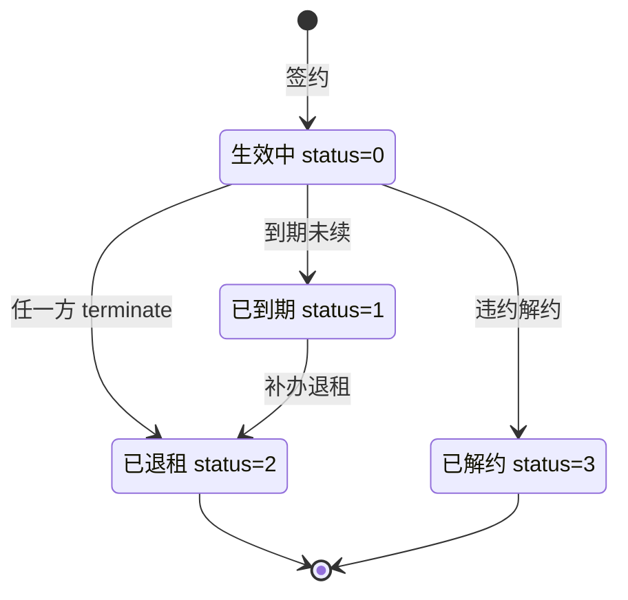

只有 `status=2` 且 `actual_end_date` 非空，评价窗口才开启；`status=1` 是中间态，不能直接评价。

**② 报修**（`repair_order.status`，6 状态）：

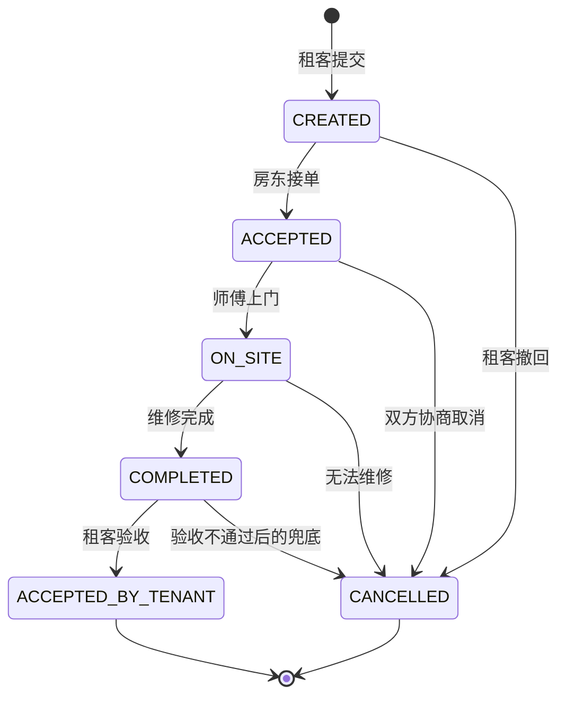

6 个状态共 6×5=30 种有向组合，上图列出合法 8 种，其余 22 种必须 409（含「同状态重复操作」与「终态回退」）。

**③ 账单**（`hrent_rent.bill_status`，4 状态）：

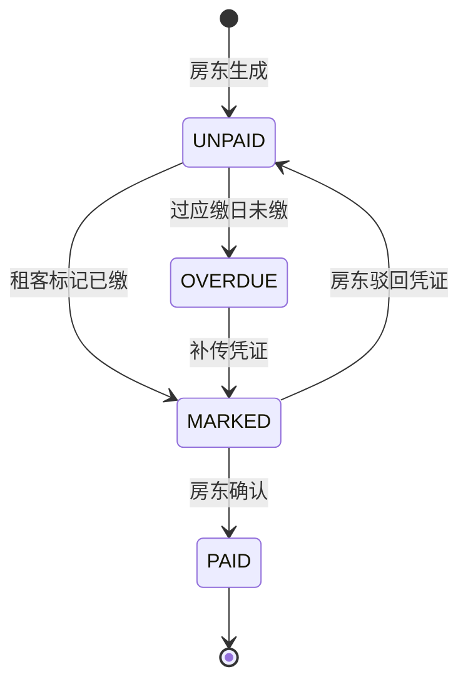

**④ 评价**（`review.status`，3 状态）：

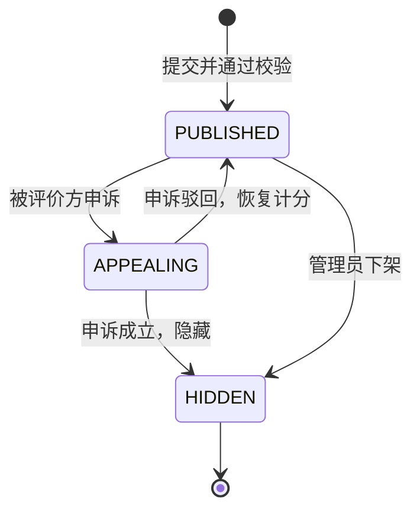

`APPEALING` 期间不计入均分，是「申诉不惩罚被评价方，也不让分数先掉」的折中。

**⑤ 房源**（`hrent_house_resource.state`，3 状态，补充）：

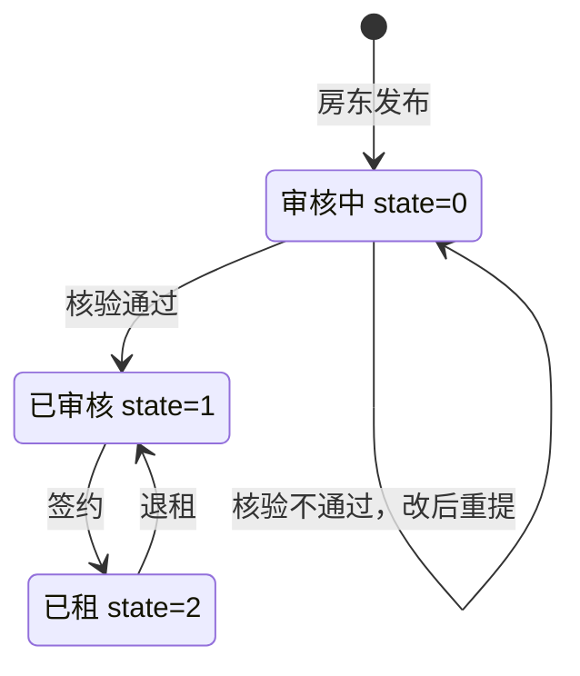

### 5.3 面向对象分析

#### 5.3.1 功能建模：用例图

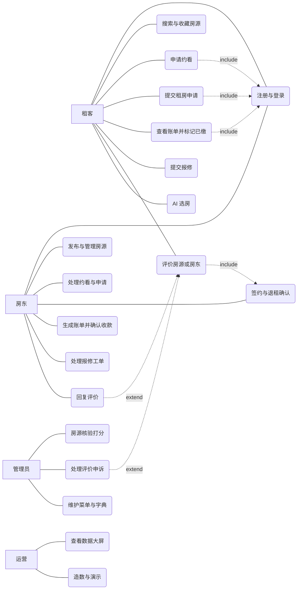

`U7 评价` 依赖 `U11 退租确认`——没退租就没有评价资格，这是 include 关系而不是「用户想评就评」。

#### 5.3.2 对象建模：类图

系统按「控制类 → 服务类 → 实体类 → Mapper」四层组织，类图只画到服务层，Mapper 用接口名代替：

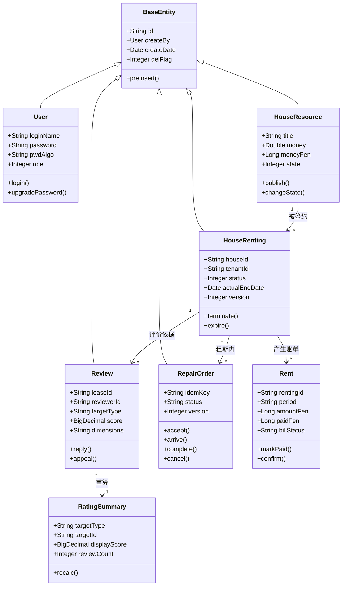

两个建模决策要写进类图注释，否则评审会问：

1. **`RatingSummary` 不继承 `BaseEntity`**：主键是 `(target_type, target_id)`，`BaseDao.get(String)` 接不了；它可重算，不需要审计字段。
2. **`Review` 的 `dimensions` 用 `String` 原样透传**：项目没有 JSON TypeHandler，为两张表引一套机制不划算；校验放服务层（G-05）。

#### 5.3.3 动态建模：顺序图

**① 签约（写租约 + 改房源状态，必须同事务）**

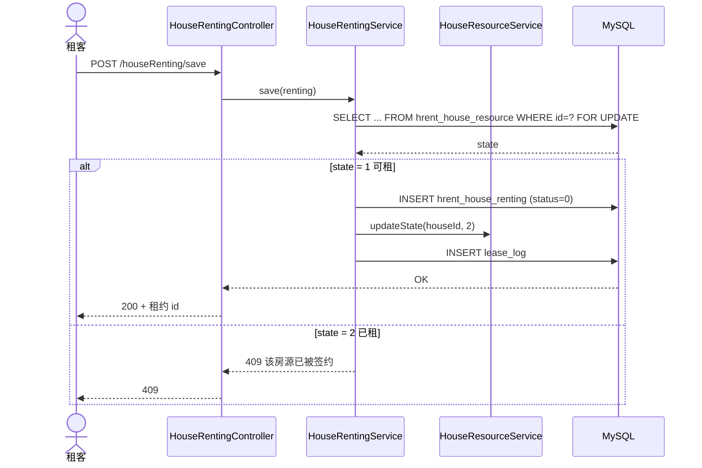

**② 退租（乐观锁 + 评价窗口起算）**

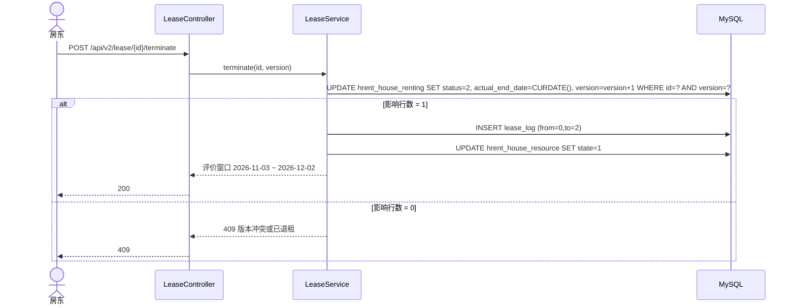

**③ 报修接单（幂等 + 抢单）**

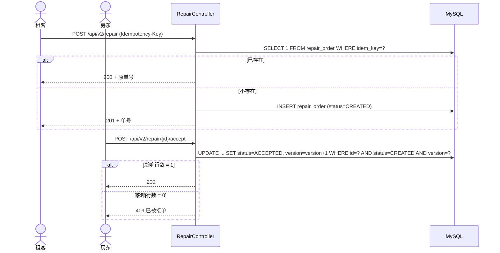

**④ 账单标记与确认（双方状态机）**

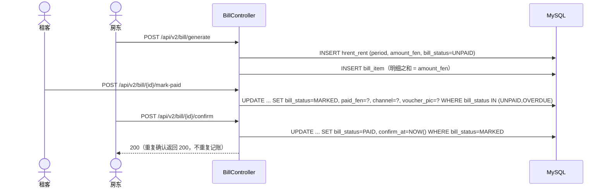

### 5.4 模型一致性核对

六个模型必须能互相对上，否则说明有一个画错了：

| 核对项 | 方法 | 当前结论 |
|---|---|---|
| DFD 加工 ↔ 用例 | 10 个加工 vs 19 个用例 | 一一覆盖，无多余加工 |
| 用例 ↔ FR | 19 个用例 vs 46 条 FR | 每个用例挂 2–6 条 FR，无孤立 FR |
| 类 ↔ 表 | 12 个核心类 vs 25 张表 | 12 张有实体，13 张为关联/日志/字典表，不建独立仓储 |
| 状态图 ↔ 枚举字典 | 5 张状态图 vs `docs/15` §3.8 | 状态值与 DB 注释逐字一致 |
| 顺序图 ↔ 接口契约 | 4 条主链路 vs 27 个 v2 端点 | 每一步都能落到一个端点 |
| 数据流 ↔ 权限矩阵 | 10 个加工 vs §2.4 | 每个加工的触发角色都在矩阵内 |

---

## 6. 需求验证与追溯

### 6.1 验证方法

| 方法 | 用在哪 | 判定 |
|---|---|---|
| 文档走查 | 46 条 FR 的 10 字段完整性 | 缺任一字段即退回 |
| 原型验证 | 27 个 v2 端点契约 | 请求/响应字段与 DDL 能对上 |
| 数据验证 | V1–V7 + `verify.sql` | 20 项全过，25 表 / 304 列 |
| 代码走查 | 状态机与幂等 | 非法迁移 100% 有 409 分支 |
| 演示彩排 | 主链路 | 3 次无阻断 |

### 6.2 追溯矩阵（三层）

| 层 | 载体 | 规模 | 用途 |
|---|---|---|---|
| 需求 → 数据 | `docs/17` §3 M1 | 46 条 FR → 表.列 → 验收 | 评审字段是否够用 |
| 需求 ↔ 接口 | `docs/17` §4 M2 | 103 存量 + 27 契约端点 | 评审契约是否闭合 |
| 表 → 迁移 | `docs/17` §6 M3 | 25 张表 → Vn 行号 | 评审迁移是否可执行 |

单条示例（FR-RATE-01 评价资格）：

```
FR-RATE-01 → hrent_house_renting(status, actual_end_date)
           → POST /api/v2/rating/submit
           → 验收：退租当天可评 / 第 30 天可评 / 第 31 天 422
           → 迁移：V2:71-77（status、actual_end_date）
```

### 6.3 覆盖率现状

| 状态 | 条数 | 占比 |
|---|---:|---:|
| 已实现 | 12 | 26% |
| 部分实现 | 4 | 9% |
| 契约已定义（无代码） | 19 | 41% |
| 仅 DDL | 6 | 13% |
| 仅设计 | 5 | 11% |

结论：存量部分是真的，新增四块（评分/报修/账单/AI）只有表和契约，**演示前必须补 Service/Controller**，否则「已实现」永远停在 35%。

---

## 7. 假设、依赖与待确认

### 7.1 假设

| ID | 假设 | 不成立的影响 | 验证方式 |
|---|---|---|---|
| A-01 | 演示并发 <20 人，单机/云托管基础版够用 | 性能指标不成立 | 压测并发曲线 |
| A-02 | 演示数据全部虚构，不使用真实房源图 | 版权与真实性风险 | 造数验收 |
| A-03 | 微信登录依赖 appid/secret，未配置时不可用 | 小程序登录无法演示 | W1 配置检查 |
| A-04 | 存量接口在线版本仍需兼容 | 老程序 500 | 103 接口快照 |
| A-05 | 5 人 / 12 周为固定约束 | 范围需等量削减 | 周度人日表 |

### 7.2 依赖

| 依赖 | 影响范围 | 缺失时的替代 |
|---|---|---|
| MySQL 8.0.41 | 全部 | 无（必须） |
| Flyway 7.7.3 | 迁移 | 手工执行脚本，但失去版本校验 |
| Ollama / DeepSeek | AI 推荐 | 规则推荐（三级降级已设计） |
| 微信开放平台 | 小程序登录 | 账号密码登录 |
| 本地磁盘 `/uploads` | 图片 | 对象存储 |

### 7.3 待确认

统一编号在 `docs/14` §8.2（T-01..T-11），本节不重复。与本报告直接相关的三条：

| 事项 | 编号 | 影响本报告哪一节 |
|---|---|---|
| 小程序 UI 库最终选型 | T-01 | §1.2.4 界面原型的验证对象 |
| 问卷与管理员访谈回收（资料缺口，暂无 T 编号） | — | §1.2.2、§1.2.3 |
| 评价维度键名冻结 | T-06 | §5.2.2 `review.dimensions` |
| 租约唯一性是否加生成列 | T-09 | §5.2.3 ① 状态图的前置条件 |

---

## 附录 A · 术语表

| 术语 | 含义 |
|---|---|
| FR | Functional Requirement，功能需求 |
| NFR | Non-Functional Requirement，非功能需求 |
| DFD | Data Flow Diagram，数据流图 |
| 加工 | DFD 中对数据做变换的处理单元 |
| 数据存储 | DFD 中静止的数据，对应数据库表 |
| 幂等键 | 同一请求重复提交只生效一次的标识（`idem_key`） |
| 乐观锁 | 用 `version` 比对实现并发控制，不锁行 |
| 逻辑外键 | 有外键语义但无数据库约束，靠应用层保证 |
| 多态关联 | 一个外键列指向多张表（`target_type` + `target_id`） |
| 贝叶斯均分 | `(5×4.0 + Σs)/(5+n)`，小样本时向 4.0 收敛 |
| 三态基线 | 脚本层 / 迁移前运行态 / 迁移后运行态 |

## 附录 B · 引用文件

| 文件 | 用途 |
|---|---|
| `docs/14_需求分析.md` | 46 条 FR 全表、C 类冲突、TBD 主台账 |
| `docs/15_数据库设计.md` | 25 张表数据字典、G 类判定、容量与安全 |
| `docs/16_ER图.md` | 35 条关系、5 张状态机、孤儿检查 SQL |
| `docs/17_需求数据模型追溯矩阵.md` | M1/M2/M3、缺口主台账 |
| `docs/13_API接口规范.md` | 103 存量端点 + 27 个 v2 契约 |
| `V1–V7`（`db/migration/`） | 数据库事实来源 |
| `db/verify.sql` | 20 项对账 |
| `db/design/99_review_diff.sql` | 评审建议 DDL，不执行 |

## 附录 C · 调研问卷（模板）

1. 你的身份：租客 / 房东 / 两者都有
2. 近 12 个月找过几次房：0 / 1 / 2 / 3 次以上
3. 找房最耗时的一步：筛房源 / 约看 / 谈价 / 签约
4. 你被「照片与实际不符」坑过几次：0 / 1 / 2 / 3 次以上
5. 约看时房东平均多久回复：1 小时内 / 半天 / 1 天 / 更久 / 不回
6. 报修最不满的环节：没人接 / 上门慢 / 修不好 / 没记录
7. 房租缴纳方式：线上转账 / 现金 / 平台代收
8. 是否遇到过押金纠纷：是 / 否
9. 是否接受 AI 推荐房源：接受 / 无所谓 / 不接受
10. 你对现有平台最想改的一点（开放题）

李克特题（1 完全不同意 – 5 完全同意）：11. 「房源信息足够判断是否值得看」；12. 「报修进度我能随时查到」；13. 「评价能反映真实情况」；14. 「账单金额我从不怀疑」。

## 附录 D · 访谈提纲

1. 最近一次找房/出租，从开始到签约花了多久？哪一步最烦？
2. 你现在怎么判断一个房源/租客靠不靠谱？
3. 报修一般怎么走？有没有出现过「修了但没人记录」？
4. 收租/交租怎么对账？有没有扯皮过？
5. 你会看评价吗？什么样的评价你会信？
6. 如果只能给平台加一个功能，你加什么？

## 附录 E · 46 条功能需求索引表

> 字段级规则、异常分支、验收标准见 `docs/14` §4；本表只用于快速定位与统计核对。

| ID | 名称 | 角色 | 优先级 | 状态 |
|---|---|---|---|---|
| FR-ACC-01 | 账号注册与登录 | 全部 | P0 | 已实现 |
| FR-ACC-02 | 微信登录 | 租客 | P0 | 已实现 |
| FR-ACC-03 | 多角色 | 全部 | P1 | 仅 DDL |
| FR-ACC-04 | 实名状态 | 房东/租客 | P2 | 仅 DDL |
| FR-ACC-05 | 密码兼容升级 | 全部 | P1 | 部分实现 |
| FR-HOUSE-01 | 房源发布/编辑 | 房东 | P0 | 已实现 |
| FR-HOUSE-02 | 房源状态 | 房东/管理员 | P0 | 已实现 |
| FR-HOUSE-03 | 搜索与筛选 | 租客 | P0 | 已实现 |
| FR-HOUSE-04 | 详情/图片/标签 | 租客 | P0 | 已实现 |
| FR-HOUSE-05 | 收藏 | 租客 | P1 | 已实现 |
| FR-HOUSE-06 | 平台核验 | 管理员 | P0 | 契约已定义 |
| FR-APPLY-01 | 约看申请 | 租客/房东 | P1 | 已实现 |
| FR-APPLY-02 | 租房申请 | 租客/房东 | P1 | 已实现 |
| FR-APPLY-03 | 合同与押金 | 租客/房东 | P1 | 部分实现 |
| FR-LEASE-01 | 签约生成租约 | 房东 | P0 | 已实现 |
| FR-LEASE-02 | 租约状态机 | 系统 | P0 | 仅 DDL |
| FR-LEASE-03 | 退租确认 | 租客/房东 | P0 | 契约已定义 |
| FR-LEASE-04 | 租约流转日志 | 系统 | P1 | 仅 DDL |
| FR-BILL-01 | 生成账单 | 房东 | P0 | 契约已定义 |
| FR-BILL-02 | 账单明细 | 房东 | P0 | 契约已定义 |
| FR-BILL-03 | 标记已缴 | 租客 | P0 | 契约已定义 |
| FR-BILL-04 | 房东确认 | 房东 | P0 | 契约已定义 |
| FR-BILL-05 | 逾期 | 系统 | P1 | 契约已定义 |
| FR-BILL-06 | 金额精度 | 系统 | P0 | 仅 DDL |
| FR-REPAIR-01 | 提交工单 | 租客 | P0 | 契约已定义 |
| FR-REPAIR-02 | 接单/上门/完成 | 房东/师傅 | P0 | 契约已定义 |
| FR-REPAIR-03 | 租客验收 | 租客 | P0 | 契约已定义 |
| FR-REPAIR-04 | 取消 | 租客/房东 | P1 | 契约已定义 |
| FR-REPAIR-05 | 工单图片 | 租客/房东 | P1 | 契约已定义 |
| FR-REPAIR-06 | 流转日志 | 系统 | P1 | 契约已定义 |
| FR-RATE-01 | 评价资格 | 系统 | P0 | 契约已定义 |
| FR-RATE-02 | 提交评价 | 租客 | P0 | 契约已定义 |
| FR-RATE-03 | 房东回复 | 房东 | P1 | 契约已定义 |
| FR-RATE-04 | 申诉 | 被评价方 | P1 | 契约已定义 |
| FR-RATE-05 | 评分汇总 | 系统 | P0 | 契约已定义 |
| FR-RATE-06 | 平台核验 | 管理员 | P0 | 契约已定义 |
| FR-AI-01 | 条件推荐 | 租客 | P0 | 仅设计 |
| FR-AI-02 | 规则抽取 | 系统 | P1 | 仅设计 |
| FR-AI-03 | 排序打分 | 系统 | P1 | 仅设计 |
| FR-AI-04 | 三级降级 | 系统 | P0 | 仅设计 |
| FR-AI-05 | 反馈埋点 | 系统 | P2 | 仅 DDL |
| FR-SYS-01 | 站内信 | 全部 | P1 | 已实现 |
| FR-SYS-02 | 数据大屏 | 管理员 | P2 | 部分实现 |
| FR-SYS-03 | 文件上传 | 全部 | P0 | 已实现 |
| FR-SYS-04 | 审计与越权 | 系统 | P0 | 部分实现 |
| FR-SYS-05 | 部署与监控 | 运维 | P1 | 仅设计 |

核对：5+6+3+4+6+6+6+5+5 = **46**；状态 12 已实现 + 4 部分 + 19 契约 + 6 仅 DDL + 5 仅设计 = **46**，与 §6.3 一致。

---

> **交付前逐项核对（对应课程要求）**
>
> | 要求 | 落点 | 结论 |
> |---|---|---|
> | 用户需求报告：调研数据、问卷调查法、实地操作、访谈、建立原型 | 第 1 章、§1.2.1–1.2.4、附录 C/D | 齐；其中问卷与 1 场访谈标【待补】 |
> | 系统需求规格说明书：功能需求 | 第 2 章、§2.3、附录 E | 齐，9 域 46 条 |
> | 软件需求规格说明书：功能性/非功能性/建模 | 第 3、4、5 章 | 齐 |
> | 结构化·功能建模：数据流图 | §5.2.1 顶层图 + 0 层图 | 齐 |
> | 结构化·数据建模：E-R 实体联系图 | §5.2.2 | 齐 |
> | 结构化·行为建模：状态转化图 | §5.2.3 五张 | 齐 |
> | 面向对象·功能建模：用例图 | §5.3.1 | 齐，19 个用例 |
> | 面向对象·对象建模：类图 | §5.3.2 | 齐，12 个核心类 |
> | 面向对象·动态建模：状态转化图 | §5.2.3 + §5.3.3 顺序图 | 齐，4 条顺序图 |
> | 模型一致性 | §5.4 六项核对 | 齐 |
> | 与评审整改一致 | V1 冻结（G-09）、M2 存在、TBD 单一编号、G-01..G-15 | 齐 |
